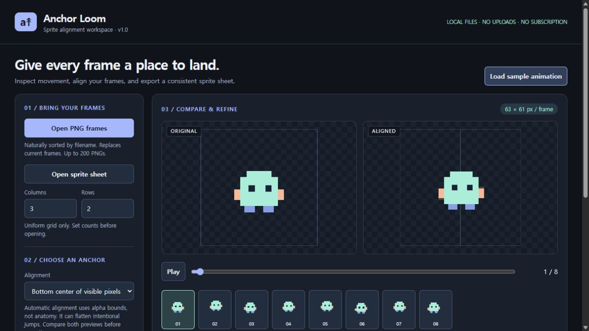

# Anchor Loom

**An offline workspace for aligning PNG animation frames.**

Compare original and aligned motion, adjust individual frames, and export a
consistent sprite sheet without sending your artwork to a server.

## What it does

- Opens PNG sequences and uniformly divided sprite sheets.
- Aligns frames by visible bottom-center or center, or preserves their placement.
- Provides per-frame pixel offsets, previous-frame overlays, and 1–30 FPS playback.
- Exports individual PNG frames, a grid sheet, and generic JSON coordinates.
- Saves editable projects containing source images and offsets.
- Runs locally in a desktop browser with no external dependencies or subscription.

## Status

Version 1.0 is available on itch.io for **$5 USD**.

[Buy Anchor Loom on itch.io](https://nasi-tools.itch.io/anchor-loom)

The application has passed local core and browser workflow checks. This repository
contains the product showcase and issue tracker. The commercial application source
and paid distribution package are not included here.

## Important limitations

Automatic alignment uses alpha bounds, not anatomy. It can remove intentional
jumps or bobbing; compare the previews and use manual offsets when needed.
Export retains source pixels without cropping or resampling.

- PNG still images only; no GIF/video import.
- Up to 200 frames, 4 million pixels per input image, and 24 million source pixels total.
- Output limits: 4096 pixels per frame side, 32 million output-frame pixels total,
  and 8192 pixels per atlas side.
- Generic JSON metadata; no engine-specific importer is included.
- Tested in a Chromium-based browser on Windows. Other operating systems remain unverified.
- Work is not automatically saved. Save an editable project before closing.

## Development and feedback

Created with AI-assisted coding and an original code-drawn sample. No third-party
artwork or customer images are included in this repository.

Issues are welcome for questions and reproducible bug reports. Include browser,
operating system, input dimensions and steps, but do not upload private or
unlicensed artwork. No response-time or future-feature guarantee is offered.

This repository does not grant a license to the commercial application.

