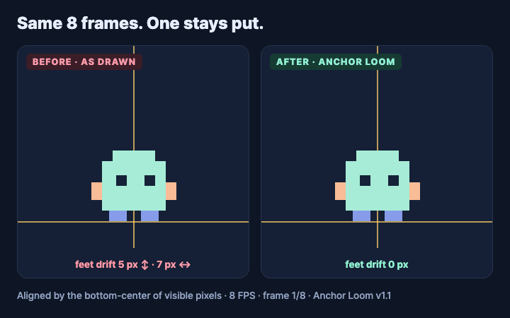

# Anchor Loom — Offline PNG Sprite Frame Alignment

**Align transparent PNG animation frames, preview motion, and export sprite sheets in a desktop browser.**

Anchor Loom helps sprite artists and indie game developers inspect unwanted frame-to-frame jitter, compare original and adjusted playback, and fine-tune offsets locally. Automatic alignment needs review to preserve intentional motion.

**[Get Anchor Loom on itch.io — $3.99 USD](https://nasi-tools.itch.io/anchor-loom)**

## What it does

- Opens PNG sequences and uniformly divided sprite sheets.
- Aligns frames by visible bottom-center or center, or preserves their placement.
- Provides per-frame pixel offsets, previous-frame overlays, and 1–30 FPS playback.
- Exports individual PNG frames, a grid sheet, and generic JSON coordinates.
- Includes Godot 4, Phaser 3, PixiJS and Roblox export files, with engine setup notes.
- Offers English and Korean interfaces, plus optional command-line and local MCP tools.
- Saves editable projects containing source images and offsets.
- Runs locally in a desktop browser with no external dependencies or subscription.

## Status

Version 1.1 is available on itch.io for **$3.99 USD** (purchase link above).

The application has passed local core and browser workflow checks. This repository
contains the product showcase and issue tracker. The commercial application source
and paid distribution package are not included here.

## Free guide: stop unwanted sprite jitter

Before buying a tool, follow the [PNG animation alignment checklist](docs/png-sprite-animation-alignment-guide.md) to identify whether the problem is alignment jitter or intentional motion. The checklist is free and does not require an account.

## Start after download

1. Download the ZIP from itch.io and extract the whole folder.
2. Open `index.html` in desktop Chrome or Edge. Keep all extracted files together.
3. Click **Load sample animation**, then **Play**, to try the included example.
4. Import your PNG frames or a uniformly divided sheet. Compare original and aligned motion, then adjust individual X/Y offsets if needed.
5. Choose **Export PNG + frames ZIP** for the output. Use **Save editable project** before closing if you want to resume later.

The browser app needs no terminal commands or Node.js installation. Optional CLI and MCP features require Node.js 18 or later. The GitHub download
contains this showcase, not the paid application; use the itch.io purchase link above.

## Important limitations

Automatic alignment uses alpha bounds, not anatomy. It can remove intentional
jumps or bobbing; compare the previews and use manual offsets when needed.
Export retains source pixels without cropping or resampling.

- PNG still images only; no GIF/video import.
- Up to 200 frames, 4 million pixels per input image, and 24 million source pixels total.
- Output limits: 4096 pixels per frame side, 32 million output-frame pixels total,
  and 8192 pixels per atlas side.
- Engine export files are included; Unity and Roblox Studio setup was documented but not tested inside those editors.
- Tested in Chromium-based browsers on Windows and macOS, and Safari on macOS.
- Work is not automatically saved. Save an editable project before closing.

## Development and feedback

Created with AI-assisted coding and an original code-drawn sample. No third-party
artwork or customer images are included in this repository.

Issues are welcome for questions and reproducible bug reports. Include browser,
operating system, input dimensions and steps, but do not upload private or
unlicensed artwork. No response-time or future-feature guarantee is offered.

This repository does not grant a license to the commercial application.
